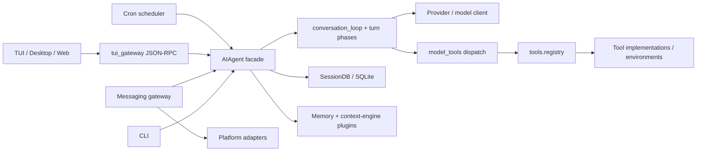

# 02 — Architecture

## Subsystems

1. **Surfaces and transports:** CLI, gateway adapters, JSON-RPC TUI gateway, dashboard, and Electron translate input/output into session and message operations.
2. **Agent runtime:** `AIAgent` receives configuration, context, and callbacks; `agent/conversation_loop.py` controls a turn, calls the model, and continues when the model returns tool calls.
3. **Capabilities:** `toolsets.py` selects groups; `tools/registry.py` stores schemas and handlers; `model_tools.py` is the dispatch/middleware seam. Providers and plugins supply implementations.
4. **State:** `SessionDB` fronts schema, message, search, and session operations. Cron maintains separate job and execution state.
5. **Background work:** gateway lifecycle, cron scheduler, memory prefetch/flush, subagents/background tools, and resource cleanup.

## Dependency direction

This is a subsystem-level call map supported by inspected symbols. It does not claim every module follows strict layering or that every UI request follows one identical path.

## Interfaces and implementations

- `run_agent.py::AIAgent` is a public-facing facade. Its constructor forwards parameters to `agent.agent_init.init_agent` ([run_agent.py L214-L285](../../run_agent.py#L214-L285)). Mixins divide lifecycle, callbacks, session, and compression behavior; the turn loop lives in a sibling module.
- `MemoryProvider` is an ABC requiring a name, availability check, initialization, and tool schemas; lifecycle hooks such as `prefetch`, `sync_turn`, and `shutdown` are in [agent/memory_provider.py L84-L150](../../agent/memory_provider.py#L84-L150). `MemoryManager` coordinates providers; it is not a model.
- `ToolEntry` packages schema and concrete handler metadata. The central registry handles discovery and dispatch. Registering a tool is Python runtime behavior, not merely publishing a schema to an LLM.
- The plugin loader dynamically imports Python modules. Not every plugin contract was inspected, so do not assume that plugins are isolated by default; in-process plugin code should be treated as trusted unless a specific isolation path is verified.

## Processes, async/sync boundaries, and shared state

- The agent loop is described by the area guide as synchronous; gateway `_handle_message` is async, and some blocking paths use `asyncio.to_thread`. Each helper must be inspected before generalizing this behavior.
- Gateway, scheduler, tool backends, and UI server have distinct process/background lifecycles. Gateway startup creates a runner and performs recovery at [gateway/run.py L5750-L5800](../../gateway/run.py#L5750-L5800). Not every child-process boundary was verified.
- Module globals, registries, and caches are process-scoped; some locks/context scopes protect state. `model_tools._last_resolved_tool_names` is documented as process-global in the agent area guide. Multiplex profiles require explicit context binding; `os.environ` is launch-scope, not session-scope.
- Persistence across processes uses SQLite/file stores and some queues. The inspected code does not justify describing the whole runtime as a distributed system or as transactionally consistent across stores.

## Implementation versus design intent

`AGENTS.md` states design goals: a narrow core, prompt-cache stability, facade/sibling modules, and plugin/skill-first extension. Those rules do not prove compliance by themselves. Source confirms decomposition in `AIAgent`, the tool registry, and `hermes_state*`; any remaining large modules should be evaluated by responsibility and change impact, not size alone.
