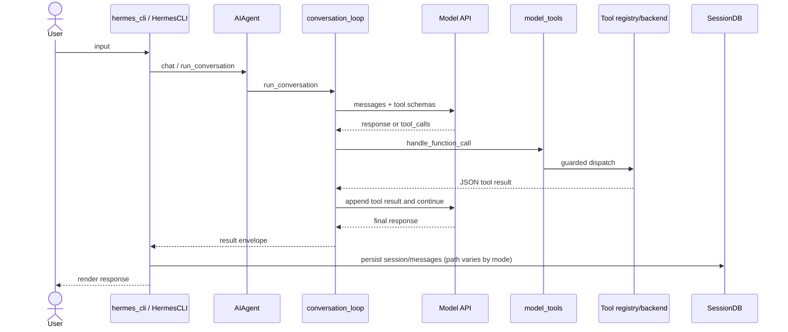
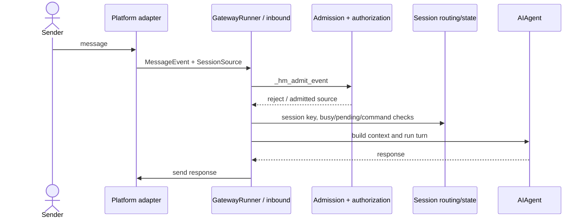
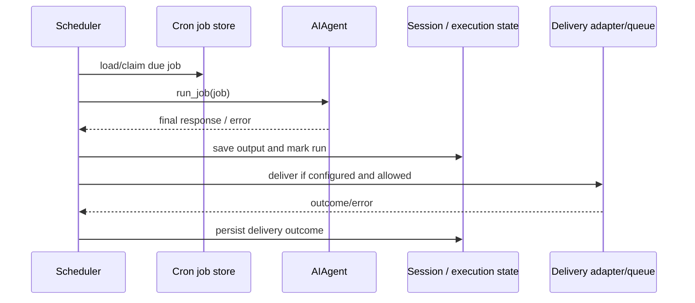

# 03 — Runtime flows

The flows below are partially traced symbol chains; gaps are explicitly marked. A Python `async def` defines a coroutine; `await` yields control to the event loop. This resembles asynchronous control flow in Node.js, but blocking Python code does not yield automatically.

## 1. CLI turn

Entry: `hermes_cli.main:main` (console script), then `HermesCLI` in `cli.py`; the agent is constructed as `AIAgent`; `run_conversation` → model request/response → `run_tool_round` → `handle_function_call` → tool registry → tool result → next iteration or response. Session persistence is provided through session persistence/`SessionDB`, but wiring for every CLI mode was not traced completely.

**Example:** The user asks to list files. The model requests `terminal`; the registry dispatches to the configured backend; its output becomes a tool message; the model then produces a final answer. This is illustrative, not an executed request. Timeout/retry/cancellation depend on provider and turn phase and have not been exhaustively inventoried. `AIAgent.__init__` currently defaults its iteration cap to `sys.maxsize` ([run_agent.py L236-L245](../../run_agent.py#L236-L245)); budgets and stop gates add separate limits.

## 2. Messaging gateway

`gateway.run:main` → `start_gateway` → `GatewayRunner`; an adapter creates a `MessageEvent`; `gateway.run_inbound::_handle_message` performs admission/authorization, derives a session key, checks pending/busy/command paths, claims an active session, and enters the agent path. Route rejection, ignored-channel checks, and authorization are visible at [run_inbound.py L185-L261](../../gateway/run_inbound.py#L185-L261); dispatch is at [L1285-L1345](../../gateway/run_inbound.py#L1285-L1345). The claim-to-send sequence varies by adapter and was not confirmed for every platform.

**Example:** An unauthorized DM may be ignored, declined, or offered pairing; it does not proceed to session/agent dispatch. An authorized event continues after its session is claimed. Error behavior such as rate limits, retries, and chunking differs by transport and was not fully audited.

## 3. Scheduled job

Job definitions use `cron/jobs.py::save_jobs`; writes are staged and atomically replaced under a lock [L1554-L1608](../../cron/jobs.py#L1554-L1608). The scheduler selects due work; `cron/scheduler.py::run_job` creates and runs an agent. It assigns a cron session ID, opens the session DB after early-return gates, runs the agent, and extracts the final response [scheduler.py L2526-L2588](../../cron/scheduler.py#L2526-L2588). `run_one_job` creates/adopts an execution record and can hand work to a worker [L2772-L2795](../../cron/scheduler.py#L2772-L2795). Delivery/status handling follows in `scheduler.py`; the exact timer/tick-to-claim path was not fully traced.

**Example:** A reminder job becomes due, creates an agent turn, saves its output, and sends to its configured target. A silent marker or missing delivery target may suppress sending. This behavior was not tested with a live scheduler. Owner fencing and cancellation hooks exist; the complete timeout/retry policy remains unverified.

## 4. Startup and shutdown

Gateway startup handles config/process guards and recovery before creating the runner at [gateway/run.py L5750-L5800](../../gateway/run.py#L5750-L5800); `main` validates config and bootstraps process identity/watchdog [L5948-L5968](../../gateway/run.py#L5948-L5968). One-shot CLI declares cleanup entries for terminal environments, delegation, browser, MCP, and auxiliary clients in [`hermes_cli/main.py`](../../hermes_cli/main.py#L100-L120). This confirms deliberate cleanup hooks, but not their completion order or every shutdown path.

Nodes from `StopAdmission` onward are a lifecycle model that needs per-path verification; they are not a confirmed order for every runtime. Startup watchdog, SIGTERM, one-shot `os._exit`, and graceful shutdown have different semantics.
